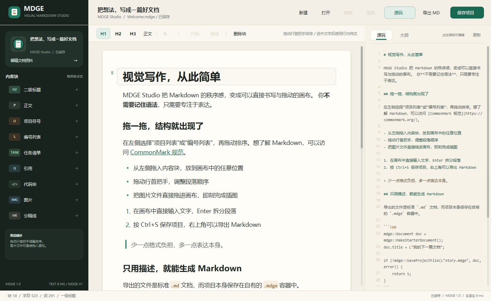
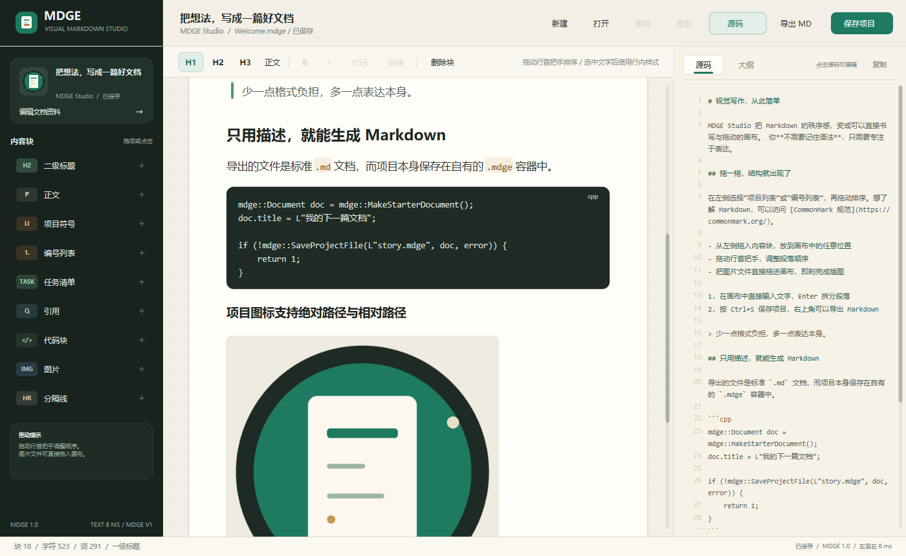
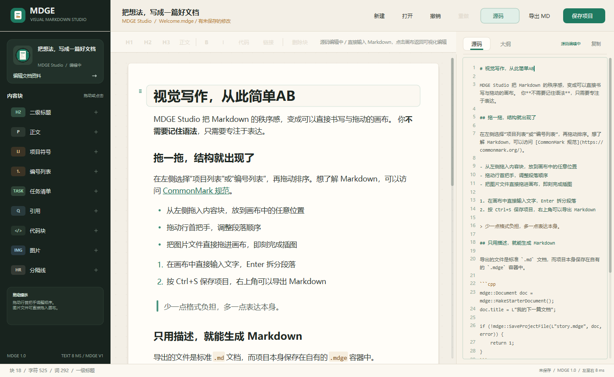
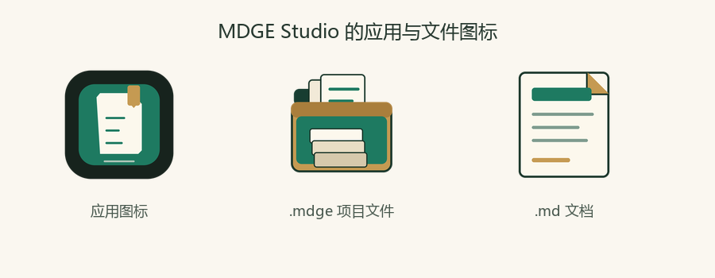
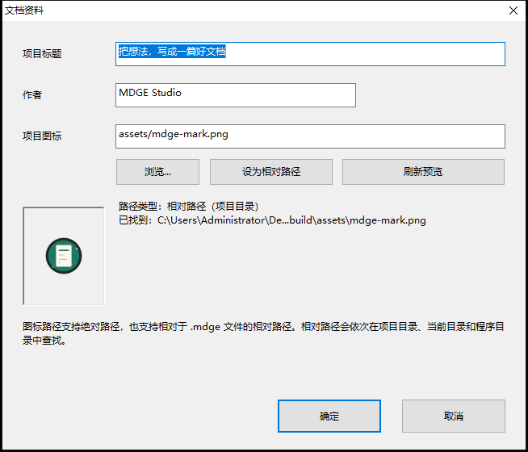

# MDGE Studio

[](https://github.com/bigcc218/MakerDownGUIeditor/actions/workflows/build.yml)
[](LICENSE)

MDGE Studio 是一个面向 Windows 的可视化 Markdown 文档编辑器，使用 C++ 和原生 Win32、Direct2D、DirectWrite 实现。它把 Markdown 的结构隐藏到可拖动的画布后面：写作者只需要输入、拖动和点击样式，不需要手写 Markdown 标记。



## 任务清单

- [x] 基本的图形化与编辑
  - [x] 保存 Markdown 文件
  - [x] 保存 MDGE 项目文件
- [x] 使应用中的“源码”部分可以编辑
- [x] 添加 GitHub 风格的任务列表项
- [x] 首次启动文件关联与独立的 `.md` / `.mdge` 图标

## 特性

- 原生 C++ 界面，无 Web 组件、无 Electron 外壳。
- 可视化内容块：一级到三级标题、正文、项目符号、编号列表、任务清单、引用、代码、图片、分隔线。
- GitHub 任务清单：可点击方框勾选、`Ctrl+Enter` 切换，并和 Markdown 源码中的 `- [ ]` / `- [x]` 双向同步。
- 鼠标拖放：从左侧拖入内容块、拖动行首把手排序、把图片文件直接拖进画布。
- 工具栏排版：加粗、斜体、行内代码与链接都通过选择和点击完成，不需要输入标记。
- 实时 Markdown 源码面板与文档大纲面板。
- Markdown 源码可以直接点击编辑：源码改动实时解析为可视化内容，画布与源码双向同步。
- 自有的二进制项目格式 `.mdge`，带版本、CRC32 校验、原子保存。
- 首次启动自动关联未关联的 `.mdge`，随后询问是否关联 `.md`；火绒等安全软件拦截时提供信任/打开方式恢复路径和诊断日志；两种文件图标独立，且都与应用图标不同。
- 单实例运行：再次双击 `.md` / `.mdge` 时通过窗口消息把文件转给已运行窗口，不创建第二个编辑器。
- 标准 Markdown 导出，图片路径保持原样并转为 `/` 分隔符。
- 项目图标支持绝对路径与相对路径；加载结果会同时用于侧栏、标题栏和任务栏图标。
- 文档文字以左到右的裁剪动画出现，总时长 **8 ms**，小于 10 ms；不会影响输入响应。
- 原生中文编辑体验：IME 候选窗口跟随光标，支持中文输入。
- 支持撤销/重做、复制/粘贴、行内样式、图片插入和键盘操作。
- 界面与图标全部由几何图形和文字绘制，不使用 emoji。

## 获取程序

到 [Releases](../../releases) 下载最新的 `MDGEStudio.exe`（单个文件、静态链接，无需安装运行时）；或者克隆仓库后运行 `build.bat` 自行编译。

当前版本 **v1.1.3**，版本号同时写入可执行文件的版本资源，可在文件属性 → 详细信息中查看。

## 运行

编译好的程序位于 `build\MDGEStudio.exe`。直接双击，或带上一个 `.mdge` 项目 / `.md` 文档启动：

```bat
build\MDGEStudio.exe samples\Welcome.mdge
build\MDGEStudio.exe samples\Welcome.md
```

项目附带了一个可直接编辑的示例：`samples\Welcome.mdge`。示例使用相对路径图标 `samples\assets\mdge-mark.png`，对应的导出结果在 `samples\Welcome.md`。直接打开 `.md` 时，内容会作为 Markdown 导入为当前文档；保存项目会创建 `.mdge` 文件，也可以继续用“导出 MD”写出 Markdown。

## 编译

要求：

- Windows 10 或 Windows 11。
- 支持 Windows GUI 和 Direct2D/DirectWrite 的 MinGW-w64 g++，已在 g++ 16.2.0 下验证。
- MinGW 自带的 `windres`，用于编译窗口图标、清单和原生设置对话框。

在仓库根目录执行：

```bat
build.bat
```

脚本会依次编译资源、程序和测试，然后运行核心测试与文件关联测试。最终产物：

- `build\MDGEStudio.exe`：应用本体，已静态链接 C++ 运行库。
- `build\core_tests.exe`：模型、文件格式、Markdown 导出与路径解析测试。
- `build\association_tests.exe`：关联状态机、注册值、图标资源 ID、SID/重试参数与恢复节流测试。

应用本体只依赖系统 DLL：Direct2D、DirectWrite、Windows Imaging Component、User32、GDI32、Shell32、Shlwapi、Advapi32（当前用户文件关联）等。

## 开发辅助脚本（可选）

`tools\` 下的 Python 脚本用于重新生成图标与示例资源，需要 Python 3 与 Pillow：

```bat
py -m pip install -r tools\requirements.txt
```

`tools\project_dump.cpp`、`tools\sample_builder.cpp` 是生成本地示例、导出项目内容的小工具，不参与 `build.bat` 与 GitHub Actions。

## 基本操作

1. 启动时项目为空，或打开 `samples\Welcome.mdge`。
2. 在左侧“内容块”中点击一个条目，它会被插入到当前块之后；也可以把条目拖到画布上的指定位置。
3. 点击画布中的文字直接编辑。`Enter` 拆分段落，`Shift+Enter` 插入软换行。
4. 悬停或选中一个块时，块左侧出现拖动把手。拖动把手即可排序。
5. 选中文字后，用 `B`、`I`、`代码`、`链接` 按钮设置行内样式。链接地址为空时会移除链接。
6. 点击右侧“源码”面板中的文本即可直接编辑 Markdown。每次修改都会实时解析并更新左侧画布；点击画布可以回到可视化编辑。
7. 点击左下角文档卡片，修改项目标题、作者与项目图标。
8. 点击右上角“保存项目”保存 `.mdge`；点击“导出 MD”生成标准 Markdown 文件。
9. 按 `Ctrl+Shift+R` 可重放一次 8 ms 的文字出现动画。

图片也可以直接从资源管理器拖进画布；选中图片后双击可以更换图片。

从左侧“任务清单”插入任务项。每按一次 `Enter` 会创建下一项；点击任务左侧的方框或按 `Ctrl+Enter` 可以切换完成状态。空任务按 `Enter` 会退出任务清单，变成普通段落。



## Markdown 源码编辑

右侧源码面板不是只读预览。点击其中任意位置即可像普通文本编辑器一样输入、删除、选择、粘贴和撤销：



- 源码改动会立即解析并同步到左侧可视化画布，标题、列表、代码块、图片和行内样式都会更新。
- 在源码编辑状态下，`Ctrl+Z` / `Ctrl+Y`、`Ctrl+A`、`Ctrl+C`、`Ctrl+X`、`Ctrl+V` 作用于源码。
- `Home` / `End` 跳到行首或行尾，`Ctrl+Home` / `Ctrl+End` 跳到全文首尾；方向键和鼠标拖选都可以正常使用。
- 源码模式下工具栏的块样式与行内样式按钮会变灰，以免误应用到可视化选区。此时请直接输入 Markdown 标记，或点击画布返回可视化编辑。
- 源码面板处于编辑状态时，“导出 MD”使用当前源码原文；“保存项目”则把当前源码解析后的内容块写入 `.mdge`。

源码解析支持编辑器使用的 Markdown 子集：

- ATX 标题、普通段落、引用、无序列表、有序列表、围栏代码块、独立图片行、分隔线。
- GitHub 任务清单 `- [ ] 任务` / `- [x] 任务`；任务逐项解析为可勾选内容块。
- 行内粗体 `**...**`、斜体 `*...*`、行内代码 `` `...` ``、链接 `[文字](地址)`、反斜杠转义。
- 可视内容块目前只有三级标题；源码中的四级到六级标题会以三级标题呈现。

表格、Setext 标题、嵌套列表、HTML 块和脚注暂不转换为对应的可视化块，会按普通段落文本保留。`.mdge` 以可视化内容块为存储主体；源码编辑后如果继续在画布中修改，未支持的结构会按可视化文本重新生成 Markdown。可以先把源码导出为 `.md`，或只使用上述支持的结构。

## GitHub 任务清单

任务清单是独立的内容块，不依赖手写 Markdown；从左侧“任务清单”添加即可：


- 点击复选框可以勾选或取消勾选，完成项的文字会变灰。
- 按 `Enter` 在当前任务后追加一个未完成任务；空任务再按 `Enter` 会退出任务清单。
- 源码面板会同步显示 `- [ ]` / `- [x]`；直接在源码中编辑任务标记也会更新画布。
- 任务项支持普通文字、行内粗体、斜体、代码和链接，并参与撤销/重做和 `.mdge` 项目保存。

## 文件关联

应用第一次启动时会检查当前用户对 `.mdge` 的关联状态：

1. `.mdge` 尚未关联时自动关联到 MDGE Studio，并写入应用 Capabilities / `RegisteredApplications`，使其出现在 Windows“默认应用”中。
2. `.mdge` 就绪后询问是否关联 `.md`。选择“是”后先备份旧的 `UserChoice`，写入 `.md` 关联，再清除 `UserChoice`，最后用 `AssocQueryString` 和实际打开命令验证；验证失败会尝试恢复原设置。选择“否”不会再次询问。
3. `.mdge` 已被其他程序关联时不会覆盖其默认值，但仍会注册“打开方式”和 Capabilities。
4. 正常桌面首次启动不需要管理员权限，也不会弹 UAC。若当前进程被安全软件限制写 HKCU（例如火绒的文件关联/行为保护），程序会检测火绒并显示专用恢复对话框，不再进行无意义的 UAC 提权：
   - **打开火绒信任设置**：将 `MDGEStudio.exe` 加入火绒信任区后，点击侧栏“修复关联”重试。
   - **使用 Windows 打开方式**：由 Windows 资源管理器处理关联；若仍然被拦截，可在资源管理器中右键文件手动选择。
5. 非火绒权限受限环境仍保留隐藏提权模式：启动同一 exe，核对提权进程与当前用户的 TokenUser SID；账户不同则不当作成功。
6. 失败的状态不会写成“已就绪”。`ProjectAssociationReady` 仅在 `.mdge` 实际指向本程序或明确由其他程序关联时写入；`.md` 同意但暂时失败时保留 `MarkdownAssociationRequested`，后续启动静默重试，不重复弹询问。
7. 旧版 `FileAssociationSetupDone` 标记会保守迁移：视为旧用户已被询问过 `.md`，不会自动再次弹出询问；仍有 `ProjectAssociationReady` 重试和“修复关联”手动入口。
8. 侧栏底部提供“修复关联”入口；手动修复不受自动提示节流限制。
9. 状态同时写入注册表和 `%LOCALAPPDATA%\MDGE Studio\association-state.ini`；安全软件拦截注册表时，已询问/待重试状态仍然保留。诊断日志位于 `%LOCALAPPDATA%\MDGE Studio\association.log`。
10. `.md` 的 `UserChoice` 会先备份到 `AssociationBackup` 或 `association-userchoice.ini`，再尝试切换；恢复失败会明确提示。

`.md` 和 `.mdge` 使用两个不同的文件图标（资源 102/103），应用图标为 101，三者互不相同：



关联图标直接嵌入程序资源中，因此只需要分发单个 `MDGEStudio.exe`，不需要额外的 `.ico` 文件。`DefaultIcon` 使用 `"<exe>",-102` 和 `"<exe>",-103`。

### Windows 10 与火绒安全软件

已经在 Windows 10 22H2 + 火绒 6.0 环境验证到：未签名程序直接写 HKCU 文件关联会被火绒静默拦截（错误码 5），调用 Windows `reg.exe` 也会被拦截；这是安全软件的策略，不是 Win10 文件关联 API 的问题。

推荐处理方式：

1. 打开火绒主界面，进入“安全设置 → 信任区/系统加固”，把 `MDGEStudio.exe` 加入信任区。
2. 回到 MDGE Studio，点击侧栏底部“修复关联”；或者重启应用触发首次关联。
3. 如果不想修改安全软件，使用资源管理器右键任意 `.mdge` 文件 →“打开方式”→“选择其他应用”→浏览到 `MDGEStudio.exe`，勾选“始终使用此应用”。`.md` 同理。
4. 应用内“使用 Windows 打开方式”也可能被火绒拦截；如果它无法完成，请在资源管理器中手动右键操作，或直接使用火绒信任区。
5. 应用会自动记录诊断日志和本地状态；如仍失败，请查看 `%LOCALAPPDATA%\MDGE Studio\association.log`，里面包含错误码、火绒检测结果和回退结果。

正常桌面（未受安全软件拦截）首次启动仍直接使用 HKCU 关联，不需要管理员权限，也不会出现 UAC。

## 图标加载：绝对路径与相对路径

项目格式中的 `iconPath` 是按原样保存的路径文本，既可以是绝对路径，也可以是相对路径：

```text
C:\Users\me\Documents\brand\logo.png     绝对路径
assets\mdge-mark.png                     相对路径
..\shared\logo.ico                       相对路径
```

相对路径按以下顺序解析，直到找到第一个存在的文件：

1. `.mdge` 项目文件所在目录
2. 程序当前工作目录
3. 程序可执行文件所在目录

设置对话框中的“浏览...”会保存一个绝对路径；“设为相对路径”会在已保存项目的前提下把图标转换为相对于项目目录的路径。也可以直接手动输入路径。设置界面的状态区域会实时显示路径类型和解析结果。



示例项目使用的是相对路径。把项目文件夹整体复制到另一台机器后，只要 `assets\mdge-mark.png` 仍在项目目录内，图标就会继续正确加载。

## 文字出现动画

整个文档页的文本在一次重绘中以水平裁剪的方式从左侧向右侧出现。动画时长定义为 `kTextRevealMilliseconds = 8.0f`，严格小于 10 ms。它会在以下时机触发：

- 打开或新建项目
- 切换右侧源码面板
- 按 `Ctrl+Shift+R` 手动重放

输入时字符按键盘/输入法的顺序即时出现，没有额外延迟。

## 项目文件

`.mdge` 不使用 JSON 或 ZIP，而是本工具定义的二进制容器：

- 文件头包含 `MDGE` 签名、主次版本、32 字节头长度、体大小、CRC32 和保留字段。
- 后续是由 `tag + 长度 + payload` 组成的记录流。
- 元数据（标题、作者、图标、时间戳）与内容块按记录存储。
- 内联样式以字符范围 span 存储，支持粗体、斜体、行内代码和链接。
- 文件尾包含固定的结束标记，保存时先写同目录临时文件再原子替换。

完整规范见 [docs/MDGE_FORMAT.md](docs/MDGE_FORMAT.md)。

## 快捷键

| 快捷键 | 功能 |
| --- | --- |
| `Ctrl+N` | 新建项目 |
| `Ctrl+O` | 打开项目 |
| `Ctrl+S` | 保存项目 |
| `Ctrl+Shift+S` | 另存为 |
| `Ctrl+E` | 导出 Markdown |
| `Ctrl+Z` / `Ctrl+Y` | 撤销 / 重做 |
| `Ctrl+X` / `Ctrl+C` / `Ctrl+V` | 剪切 / 复制 / 粘贴 |
| `Ctrl+A` | 选中当前内容块全部文字；源码编辑中选中全部源码 |
| `Ctrl+B` / `Ctrl+I` | 加粗 / 斜体 |
| ``Ctrl+` `` | 行内代码 |
| `Ctrl+K` | 设置链接 |
| `Ctrl+1` / `Ctrl+2` / `Ctrl+3` | 一级 / 二级 / 三级标题 |
| `Ctrl+0` | 正文 |
| `Ctrl+Shift+P` | 显示或隐藏源码面板 |
| `Ctrl+Shift+R` | 重放 8 ms 文字出现动画 |
| `Ctrl+Enter` | 切换当前任务项的完成状态 |
| `Enter` | 画布中拆分内容块；任务后追加下一项；源码编辑中插入换行 |
| `Shift+Enter` | 在内容块内插入软换行 |
| `Tab` | 画布代码块或源码编辑中插入四个空格 |
| `Esc` | 取消拖动、退出源码编辑或清除选择 |

源码编辑状态下，可视化的块样式和行内样式快捷键不会生效；请直接输入 Markdown 标记，或点击画布切换回可视化编辑。

## 目录结构

```text
src/app/        Win32 窗口、Direct2D 绘制、编辑交互、对话框
src/core/       文档模型、UTF-8、路径、.mdge 读写、Markdown 导出与解析
resources/      应用与关联文件图标、应用清单、原生对话框模板
samples/        示例项目、导出结果与示例图标
tests/          核心逻辑与文件关联测试
tools/          图标生成、示例生成与项目导出脚本
docs/           格式规范和界面截图
build.bat       Windows 构建脚本
```

## 验证

本项目自带测试覆盖 UTF-8 转换、CRC32 标准向量、内联样式与链接编辑、块拆分/合并、Markdown 导出与解析、GitHub 任务清单解析与状态块往返、`.mdge` 保存/加载往返、损坏校验、绝对/相对资源路径解析，以及文件关联状态机、旧标记迁移、OpenWith 判定、Capabilities/DefaultIcon 注册值、SID 参数、恢复提示节流和 `.md` 询问重试等。

```bat
build.bat
```

只运行已构建的测试：

```bat
build\core_tests.exe
build\association_tests.exe
```

## 当前范围

- 仅面向 Windows 桌面。
- 可以直接打开 `.mdge` 项目和拖入图片；通过文件关联双击 `.md` 会作为 Markdown 导入，打开按钮目前仍以 `.mdge` 项目为主。
- Windows 10 上若火绒的文件关联保护拦截未签名程序，首次关联需要先将 `MDGEStudio.exe` 加入火绒信任区，或在资源管理器中手动选择“打开方式”；程序本身不会静默绕过安全软件。
- 表格、嵌套列表、Setext 标题和 HTML 块暂不转换为对应可视化块。
- 跨块文本选择不在当前版本范围内。
- 行内样式在当前内容块内应用，文件格式本身可以保存任意数量的样式 span。

界面中的图标是自绘的几何图形，示例内容和文档也刻意不使用 emoji。

## 参与贡献

欢迎提交 Issue 与 Pull Request，流程见 [CONTRIBUTING.md](CONTRIBUTING.md)。每次推送和 PR 都会在 GitHub Actions 的 Windows + MinGW-w64 环境中编译并运行 `core_tests` 和 `association_tests`。

## 许可证

本项目以 [MIT 许可证](LICENSE)开源：你可以自由使用、修改、分发和商业使用，只需保留版权与许可证声明；软件按“原样”提供，不附带任何担保。
